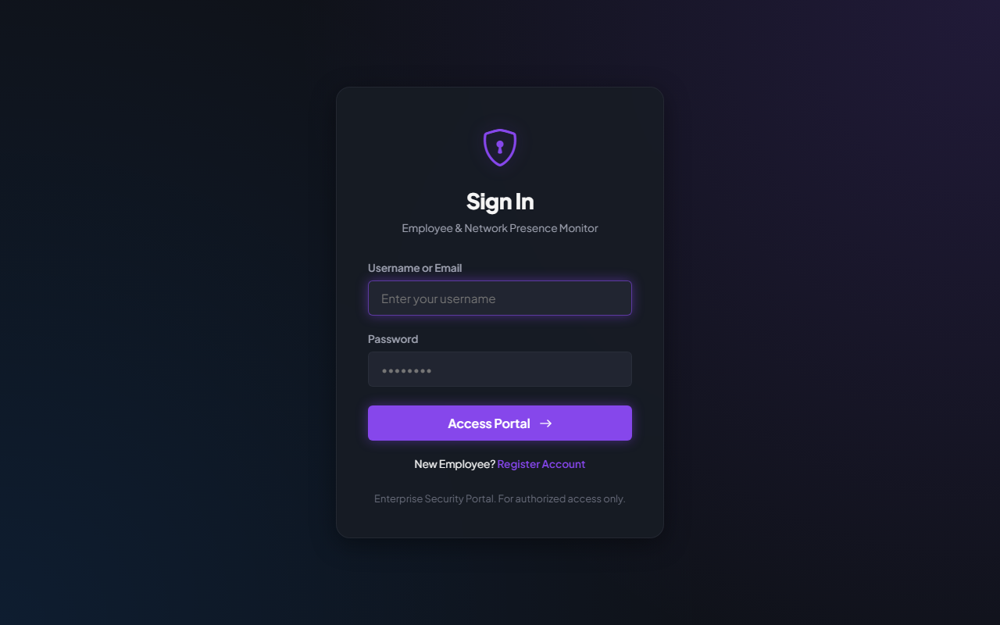
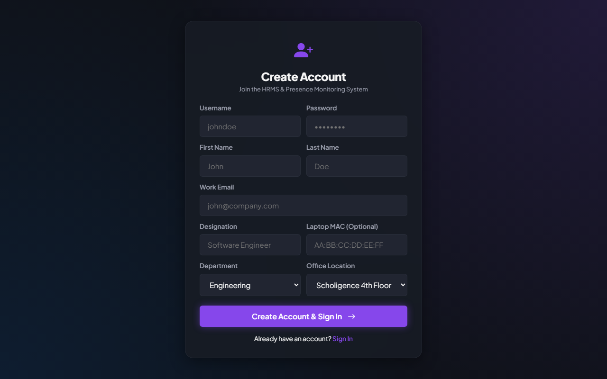
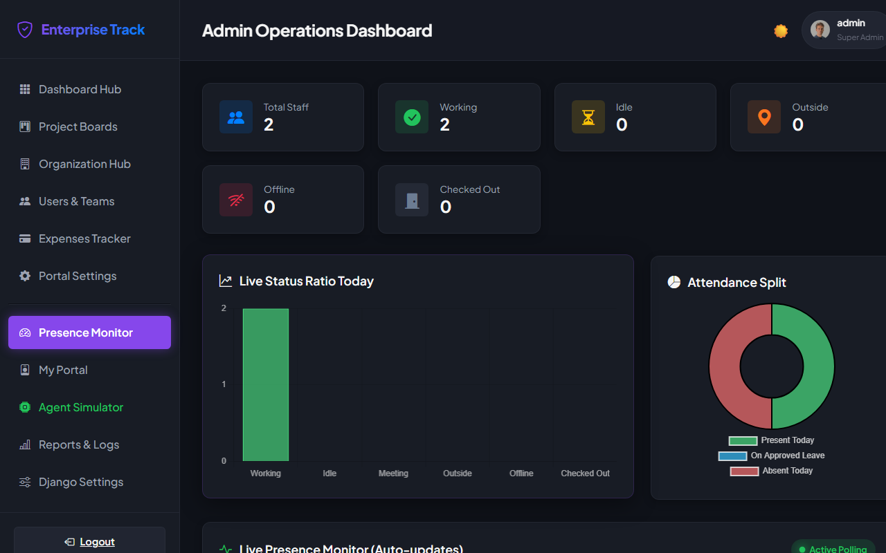
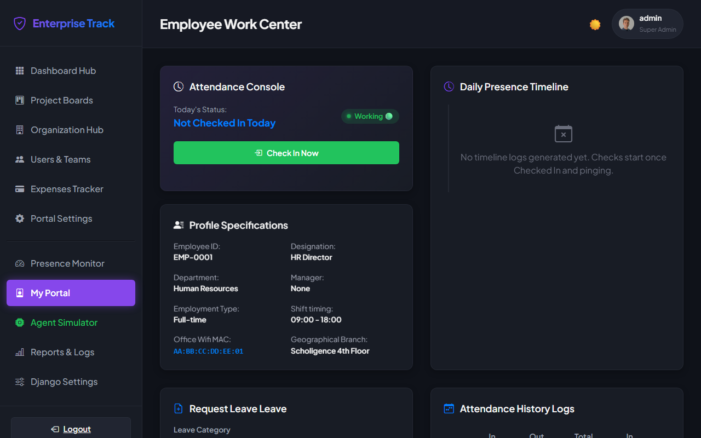
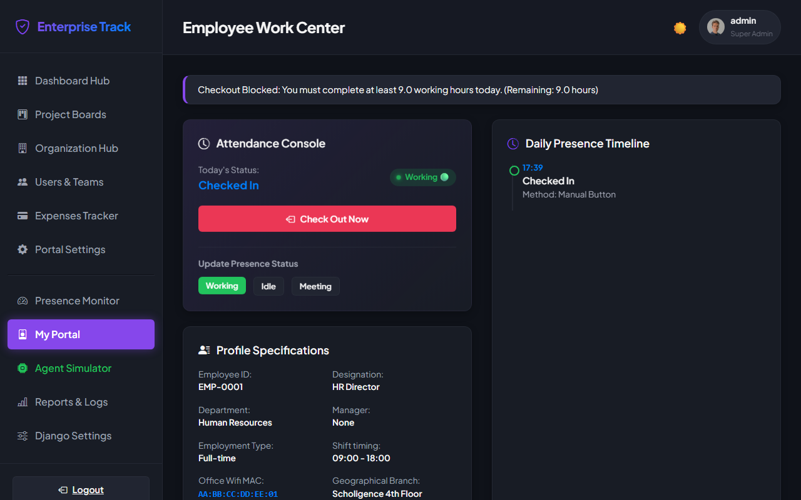
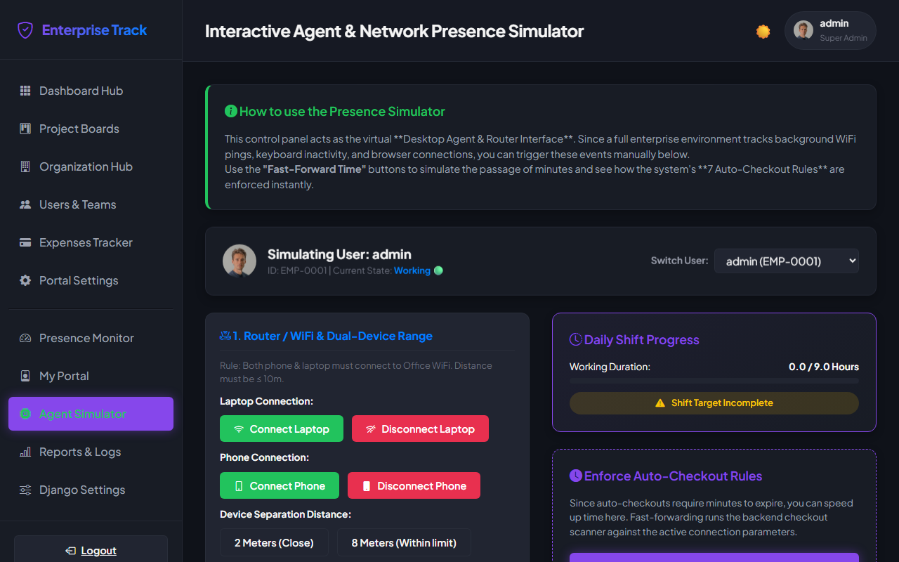
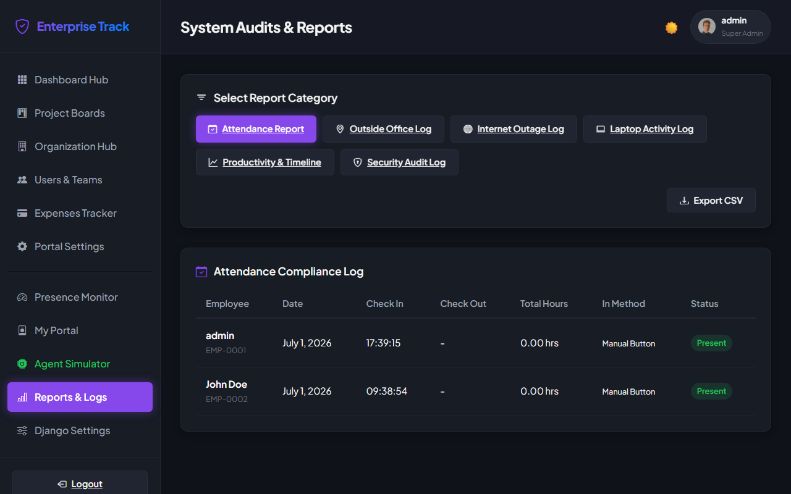
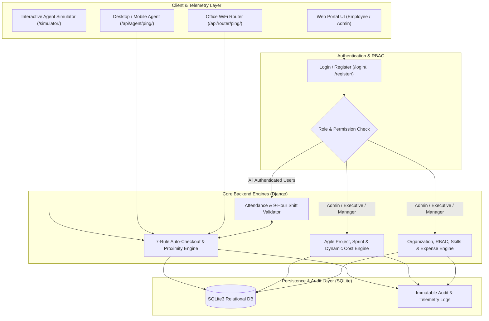
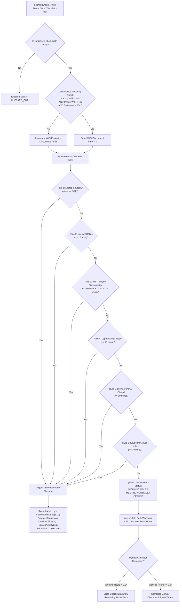
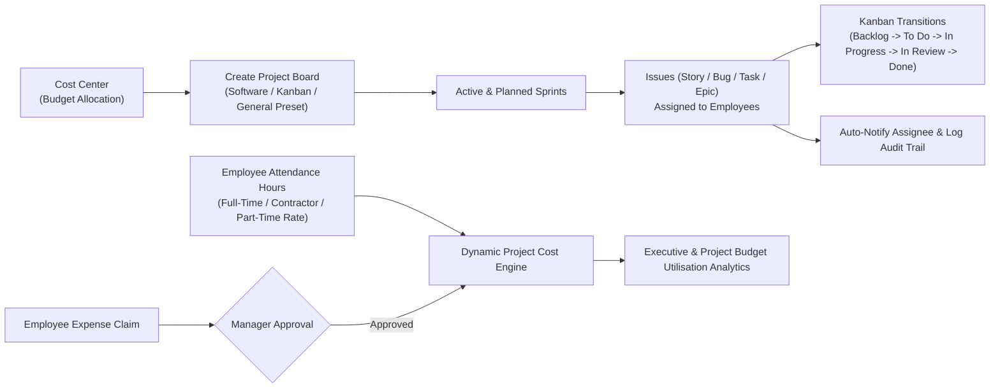

 # 🛡️ Enterprise Track — Presence, Network Geofencing & Project Management Suite

[](https://www.djangoproject.com/)
[](https://www.python.org/)
[](https://www.sqlite.org/)
[](https://www.chartjs.org/)
[](https://playwright.dev/)

**Enterprise Track** is a full-stack **Enterprise Attendance, Network Geofencing, Real-Time Presence Monitoring, and Agile Project Management Portal** built with Django. It combines hardware MAC verification, dual-device (laptop + phone) proximity & office WiFi tracking, an automated 7-rule compliance engine, and a Jira-style project/sprint management hub in a modern dark-mode glassmorphic UI.

---

## 📸 Screenshots & Screen Walkthrough

### 1. 🔐 Authentication & Employee Onboarding (`/login/` & `/register/`)
Employees and administrators sign in through a secure portal or onboard with their full profile details, department, office location, and optional hardware **Laptop MAC Address** (`AA:BB:CC:DD:EE:FF`) for automated router bindings. Every login and registration event is recorded in the security audit trail with IP tracking.

| Sign In Screen (`/login/`) | Account Registration (`/register/`) |
|:---:|:---:|
|  |  |

---

### 2. 📊 Admin Operations & Live Presence Monitor (`/dashboard/`)
Provides administrators and managers with a live, auto-polling operations command center:
- **Live Status Counters:** Total Staff, Working, Idle, Outside Office, Offline, and Checked Out.
- **Visual Analytics (Chart.js):** Real-time bar chart of **Live Status Ratio Today** and doughnut chart of **Attendance Split** (Present Today, On Approved Leave, Absent Today).
- **Live Presence Table:** Auto-updates via `/api/dashboard/stats/` showing each employee's current status badge, assigned MAC address, last seen IP, session duration, and active vs. idle hours.
- **Company Routers & Leave Approval Center:** Monitors online/offline status of office WiFi gateways (`SSID`, `Gateway IP`, `Branch`) and provides one-click **Approve / Reject** actions for pending employee leave applications.



---

### 3. 💼 Employee Work Center (`/portal/`)
The personal attendance and activity console for employees:
- **Attendance Console:** One-click manual Check-In / Check-Out and real-time presence status switcher (`Working`, `Idle`, `Meeting`).
- **Profile Specifications:** Displays Employee ID, Designation, Department, Manager, Employment Type, Shift Timing (`09:00 - 18:00`), Office WiFi MAC, and Geographical Branch.
- **Daily Presence Timeline:** Chronological visual feed combining check-ins, laptop agent state transitions (CPU usage & active foreground app), WiFi range disconnects/reconnects, and internet outage events.
- **Leave Application & Attendance History:** Built-in form to request Sick, Casual, Annual, or Unpaid leave alongside a historical timesheet log.



---

### 4. ⚠️ Strict 9-Hour Shift Checkout Validation (`/portal/checkout/`)
When an employee attempts to manually check out before completing the mandatory **9.0 working hours** target, the rules engine blocks the checkout, calculates the exact remaining hours required, and displays a high-visibility compliance alert while maintaining their active session.



---

### 5. 🖥️ Interactive Agent & Network Presence Simulator (`/simulator/`)
A built-in virtual **Desktop Agent & Router Control Panel** to test and demonstrate real-time hardware, network, and proximity events without needing physical router disconnects:
- **User Switcher:** Simulate events for any registered employee profile.
- **1. Router / WiFi & Dual-Device Range:** Connect/disconnect Laptop WiFi, connect/disconnect Phone WiFi, and adjust **Device Separation Distance** (`2m Close`, `8m Within Limit`, `15m Exceeded` > 10m limit).
- **2. Laptop Power & Screen State:** Trigger `Active Work`, `Lock Screen`, `Unlock Screen`, `Sleep Laptop`, or `Shutdown Laptop`.
- **3. Office Internet Connection:** Simulate `Internet Restored` or `Internet Lost`.
- **4. Browser Portal Session:** Simulate `Open Portal` or `Close Portal`.
- **5. Active Input & Mouse Activity:** Simulate keyboard/mouse inputs or force idle state.
- **Fast-Forward Time Clock (`+5m`, `+15m`, `+30m`):** Advances simulated timers and immediately executes the backend **7 Auto-Checkout Rules Engine**, updating the live parameter readout and daily 9-hour progress bar.



---

### 6. 📈 System Audits & Multi-Category Reports (`/reports/`)
Comprehensive auditing and compliance reporting hub with CSV export support and 6 specialized views:
1. **Attendance Report:** Check-in/out timestamps, total hours, check-in method, and Present/Late/Absent badges.
2. **Outside Office Log:** WiFi disconnection/reconnection timestamps, outside duration in seconds, and reason codes.
3. **Internet Outage Log:** Connection lost/restored timestamps, downtime duration, and whether auto-checkout was triggered.
4. **Laptop Activity Log:** Desktop agent telemetry (`ACTIVE`, `LOCK`, `SLEEP`, `OFF`), active application name, idle seconds, and CPU usage percentage.
5. **Productivity & Timeline:** Breakdown of Working Hours, Idle Hours, Break Hours, Away Hours, and computed **Work Ratio %**.
6. **Security Audit Log:** Global immutable log of `LOGIN`, `LOGOUT`, `CHECK_IN`, `CHECK_OUT`, `AUTO_CHECKOUT`, `STATUS_CHANGE`, `ISSUE_TRANSITION`, and `ROLE_MODIFIED` events with IP addresses.



---

## 🧩 Complete Application Screens Directory

In addition to the core presence screens shown above, the sidebar provides access to the full **Enterprise Management Suite**:

| Screen / Module | Route | Key Capabilities |
| :--- | :--- | :--- |
| **Dashboard Hub** | `/dashboard/hub/` | 5-tab unified command center: **Personal** (tasks, deadlines, leaves), **Executive** (company-wide budgets, costs, live attendance, audit feed), **Team** (rosters, availability, story point workload), **Project** (sprint burn-up, budget vs. actual cost, bug counts), and **Department** (divisions & departmental leave approvals). |
| **Project Boards** | `/projects/` | Create, clone, archive, and delete projects using presets (**Software Sprint**, **Kanban**, **General PM**). Dynamically calculates real-time project costs from approved expenses + employee labor hours (`Full-Time`, `Contractor`, `Part-Time` hourly rates). |
| **Kanban, Backlog & Gantt** | `/projects/<id>/board/` | Interactive 5-column **Kanban Board** (`Backlog`, `To Do`, `In Progress`, `In Review`, `Done`), **Sprint & Backlog Manager**, and visual **Gantt Chart Timeline** for tasks, bugs, stories, and epics. |
| **Organization Hub** | `/organization/` | Interactive **Employee Reporting Hierarchy Tree**, **Companies & Corporate Branches** directory, **Divisions & Departments** mapping, and **Corporate Cost Centers** budget allocations. |
| **Users & Teams** | `/users/` | **User Directory & Skills Matrix** (add/remove employee skills with Beginner/Intermediate/Expert tags), **Custom Team Builder**, **RBAC Role Manager** (`Admin`, `Executive`, `Manager`, `Team Lead`, `Employee`), and **Login History Audits**. |
| **Expenses Tracker** | `/expenses/` | Employee payout claim submission linked to projects (`Software License`, `Travel & Lodging`, `Hardware`, `Meals`) and a manager **Pending Approvals Queue** that automatically updates project cost totals upon approval. |
| **Portal Settings** | `/settings/` | Toggleable **Dashboard Hub Widgets** (`Workload`, `Deadlines`, `Performance`, `Calendar`, `Health`, `Attendance`), **Simulated TOTP MFA** (QR code & recovery codes), and **Enterprise SSO** (`Google Workspace`, `Okta SAML`) status controls. |

---

## 🔄 Project Workflow & System Architecture

### 1. End-to-End System Workflow



---

### 2. Presence Monitoring & The 7 Auto-Checkout Rules Workflow

The compliance engine in [`tracker/rules.py`](tracker/rules.py) (`enforce_checkout_rules`) evaluates every real-time ping and simulated time-tick against **dual-device WiFi connectivity**, **phone-to-laptop proximity**, and **activity thresholds**:



#### Summary of Enforced Rules
1. **Dual-Device & 10m Proximity Rule:** Both the employee's assigned **Laptop** and **Phone** must be connected to the authorized office WiFi router and within **10 meters** of each other. Exceeding 10m or disconnecting either device marks the employee as `OUTSIDE` immediately and triggers **Auto-Checkout after 15 minutes**.
2. **Laptop Shutdown Rule:** Powering off the laptop (`state == 'OFF'`) triggers **Immediate Auto-Checkout**.
3. **Laptop Sleep Rule:** Entering sleep mode (`state == 'SLEEP'`) marks the user `OFFLINE` and triggers **Auto-Checkout after 15 minutes**.
4. **Internet Outage Rule:** Losing internet connectivity triggers **Auto-Checkout after 10 minutes** and records an `InternetStatusLog`.
5. **Browser Tab Closed Rule:** Closing or deactivating the portal session triggers **Auto-Checkout after 10 minutes**.
6. **Inactivity / Idle Rule:** Locking the screen or 10+ minutes of no keyboard/mouse input transitions status to `IDLE`; **30 minutes** of inactivity triggers **Auto-Checkout**.
7. **Strict 9-Hour Daily Shift Rule:** Manual checkout is blocked unless `working_hours_today >= 9.0`.

---

### 3. Agile Project, Sprint & Dynamic Costing Workflow



---

## 🗄️ Project Structure

```text
ATTENDANCE_TRACKER/
├── enterprise_tracker/          # Django project configuration (settings, root URLs, WSGI/ASGI)
├── tracker/                     # Core application package
│   ├── management/commands/
│   │   └── seed_data.py         # Populates companies, branches, routers, users, projects & logs
│   ├── migrations/              # Database schema migrations
│   ├── static/tracker/
│   │   ├── style.css            # Glassmorphic dark/light theme CSS design system
│   │   └── main.js              # Live dashboard polling, Kanban updates, simulator & modals
│   ├── templates/tracker/       # Responsive HTML5 templates for all 12+ portal views
│   ├── models.py                # 21 relational models (Attendance, Presence, Projects, Org, RBAC)
│   ├── rules.py                 # 7-Rule Auto-Checkout & 9-Hour Shift compliance engine
│   ├── api.py                   # REST endpoints for live stats, simulator, desktop agent & routers
│   ├── views.py                 # Controllers for dashboards, Kanban boards, org hub & reports
│   └── urls.py                  # Application URL routing table
├── screenshots/                 # Automated Playwright UI captures
├── take_screenshots.py          # Headless Chromium screenshot generator script
├── flowchart.md                 # Companion mobile/agent architecture notes
└── manage.py                    # Django CLI utility
```

---

## 🔌 REST API Endpoints

| Endpoint | Method | Description |
| :--- | :---: | :--- |
| `/api/dashboard/stats/` | `GET` | Returns live aggregated counts (`working`, `idle`, `meeting`, `outside`, `offline`, `checked_out`) and per-employee session durations for AJAX polling. |
| `/api/simulator/event/` | `POST` | Triggers simulated hardware/network events (`router_connect`, `router_disconnect`, `phone_connect`, `phone_disconnect`, `set_distance`, `laptop_active`, `laptop_lock`, `laptop_sleep`, `laptop_shutdown`, `internet_offline`, `browser_close`, `tick_time`). |
| `/api/agent/ping/` | `POST` | Receives 1-minute heartbeat telemetry from desktop/mobile agents (`mac_address`, `state`, `cpu_usage`, `active_app`, `idle_seconds`). |
| `/api/router/ping/` | `POST` | Synchronizes connected device `mac_list` from office WiFi routers (`router_ip`) and evaluates proximity/checkout rules across all employees. |
| `/api/issue/<id>/status/` | `POST` | Updates Kanban issue status (`BACKLOG`, `TODO`, `IN_PROGRESS`, `IN_REVIEW`, `DONE`) and records an `ISSUE_TRANSITION` audit log. |

---

## 🚀 Getting Started

### 1. Clone the Repository
```bash
git clone https://github.com/PLAYGROUND-SHOWCASE/ATTENDANCE_TRACKER.git
cd ATTENDANCE_TRACKER
```

### 2. Install Dependencies
```bash
pip install django playwright
playwright install chromium
```

### 3. Apply Migrations & Seed Enterprise Data
```bash
python manage.py migrate
python manage.py seed_data
```

### 4. Start the Development Server
```bash
python manage.py runserver
```
Open **`http://localhost:8000/`** in your browser.

---

## 🔑 Default Seeded Credentials & Test Data

Running `python manage.py seed_data` initializes a complete enterprise environment:

| Role | Username | Password | Employee ID | Assigned MAC | Designation |
| :--- | :--- | :--- | :--- | :--- | :--- |
| **Super Admin / HR Director** | `admin` | `admin` | `EMP-0001` | `AA:BB:CC:DD:EE:01` | HR Director |
| **Team Lead / Developer** | `developer` | `password123` | `EMP-0002` | `AA:BB:CC:DD:EE:02` | Lead Developer |

**Seeded Infrastructure & Entities:**
- **Company & Branches:** `Scholigence Technology Corp` (`Boston HQ`, `London Branch`)
- **Departments & Divisions:** `Engineering` (`Core Platform`, `Cloud Services`), `Human Resources` (`Talent Acquisition`), `Sales`
- **Office Location & WiFi Router:** `Scholigence 4th Floor` (100m geofence) with `Cisco HQ-Router-01` (`SSID: Enterprise-WiFi-01`, `Gateway: 192.168.1.1`, `MAC: 00:1A:2B:3C:4D:5E`)
- **Cost Centers & Projects:** `RD-2026` (\$150,000) & `OPS-2026` (\$80,000), active project **`Jira Platform Revamp (JIRA)`** with `Sprint 1: Bootstrap Kanban`, sample stories/bugs/tasks, team `Titan Sprints`, and sample expense claims.

---

## 🧪 Regenerating Screenshots Automatically

To reset the database to a clean seed state and capture fresh screenshots of the web portal using Playwright:
```bash
python take_screenshots.py
```
