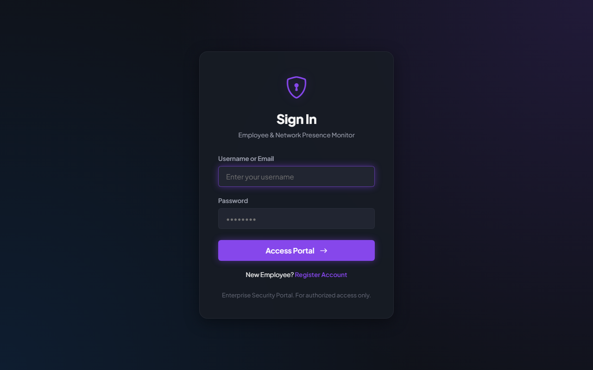
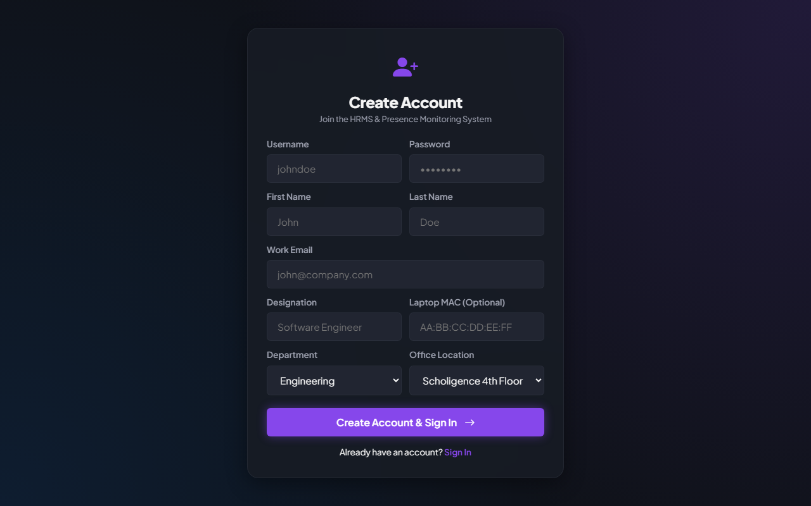
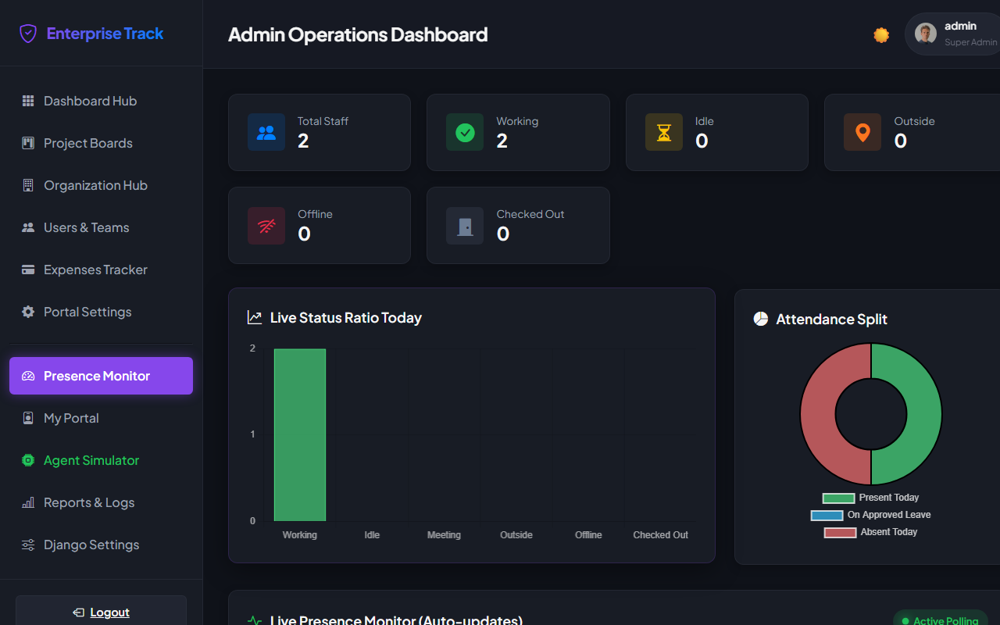
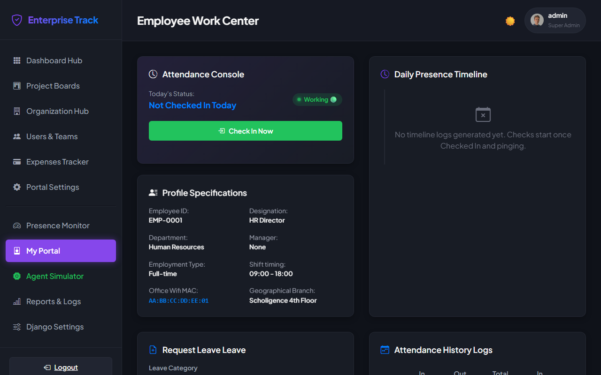
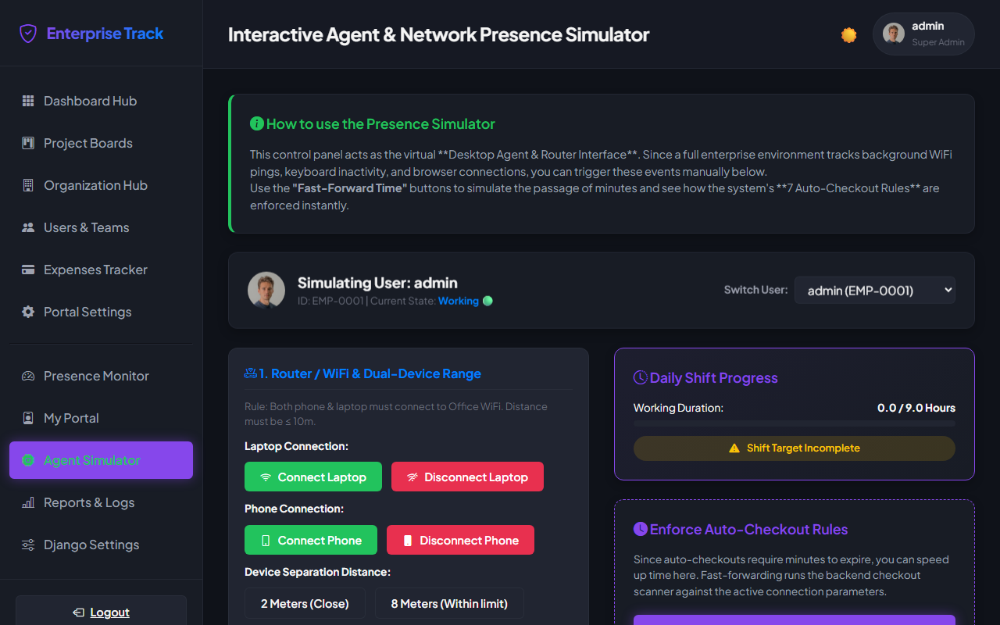
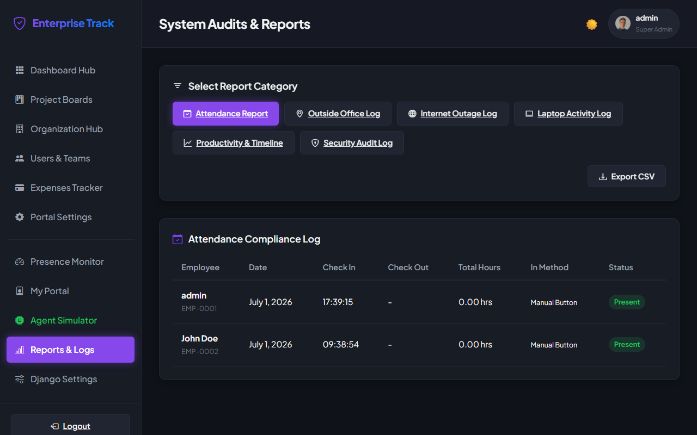
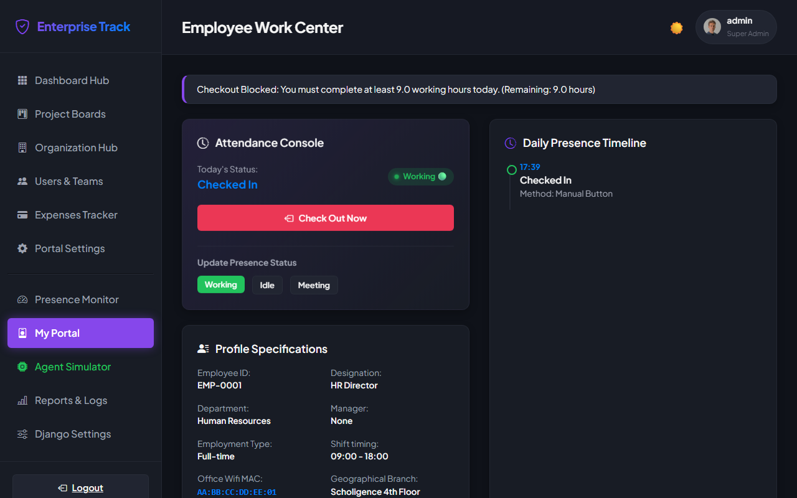
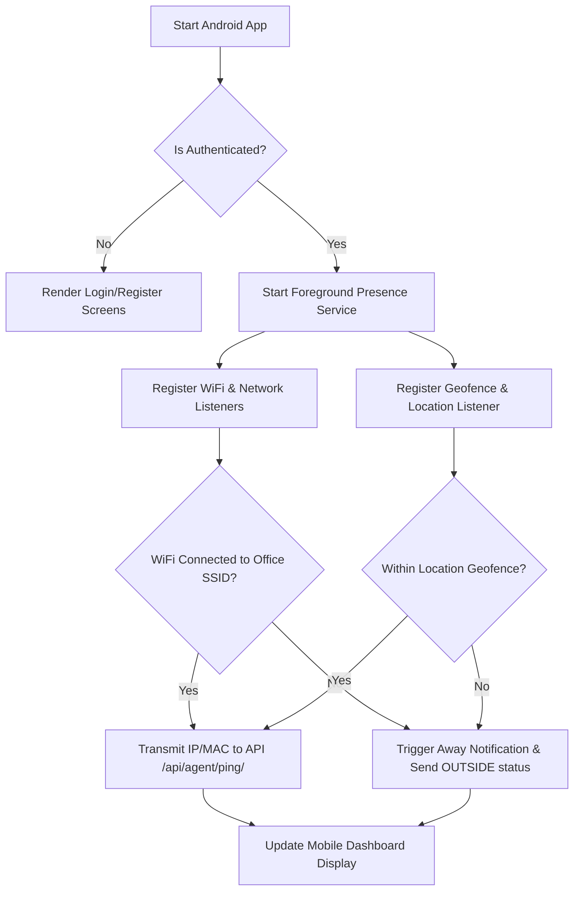

# Companion Android App Architecture & Flow

This document details the system design, background workflows, user interface components, and API integration paths for building a companion Android Mobile App for the **Enterprise Employee Management & Presence Monitoring System**.

---

## 📸 Captured Web Portal Interfaces

The web system pages captured during the verification run showcase the updated features (WiFi/distance presence rules, 9-hour target counter, and checkout warnings):

````carousel

<!-- slide -->

<!-- slide -->

<!-- slide -->

<!-- slide -->

<!-- slide -->

<!-- slide -->

````

---

## 📱 Mobile App Architecture Flow

The mobile app operates as a background service client that reports presence parameters (WiFi SSID connection, local IP, GPS geofencing coords, and lock states) to the server.



---

## 🛠️ Key Android Implementation Steps

### 1. Networking & WiFi Scan (Background Broadcast Receiver)
To monitor office WiFi networks, the app registers a network connectivity callback:
```kotlin
val connManager = context.getSystemService(Context.CONNECTIVITY_SERVICE) as ConnectivityManager
val networkRequest = NetworkRequest.Builder()
    .addTransportType(NetworkCapabilities.TRANSPORT_WIFI)
    .build()

connManager.registerNetworkCallback(networkRequest, object : ConnectivityManager.NetworkCallback() {
    override fun onAvailable(network: Network) {
        val wifiInfo = wifiManager.connectionInfo
        val ssid = wifiInfo.ssid.replace("\"", "")
        val bssid = wifiInfo.bssid
        
        // Evaluate if SSID matches the office SSID config
        checkWiFiConnection(ssid, bssid)
    }
})
```

### 2. Geofencing Service (Google Play Services API)
Define geofence triggers around the configured coordinates of the office:
* Set circular geofences using latitude/longitude with radius limits (e.g., 100 meters).
* Capture `GEOFENCE_TRANSITION_ENTER` and `GEOFENCE_TRANSITION_EXIT` events.
* Transmit states to `/api/agent/ping/` on exit/entry.

### 3. Foreground Presence Syncing (WorkManager & Foreground Service)
* Run a persistent Foreground Service displaying a sticky notification (e.g., *"Tracking Office Presence..."*).
* Periodically sync system parameters every 15 minutes using `PeriodicWorkRequest` to handle cases where background process limits occur.

### 4. API Request Body Specification
```json
{
  "mac_address": "AA:BB:CC:DD:EE:02",
  "state": "ACTIVE",
  "cpu_usage": 1.2,
  "active_app": "Android Client App",
  "idle_seconds": 0,
  "bssid": "00:1A:2B:3C:4D:5E",
  "ssid": "Enterprise-WiFi-01"
}
```
